# SportsShed (LG-5) — Postman Output Screenshots

> **Client Brief Reference:** `JP-GAI2A-G05` · Theme 20 of 30 · Equipment issue  
> **Group LG-5 Members:** B. Navdeep, Yashwanth, Varun, Charan, Vikranth, Varshith  
> **Server Base URL:** `http://localhost:3000`

All screenshots below are captured in the official Postman dark theme layout matching the course reference format, showing the URL address bar, HTTP method, request parameters/body, status code, response time/size, formatted response body, and the console log.

---

## Table of Contents
1. [Build This: Standard Requirements](#1-build-this-standard-requirements)
   - [1. Add Player (`POST /players/`)](#1-add-player)
   - [2. Add Kit (`POST /kits/`)](#2-add-kit)
   - [3. Get All Kits (`GET /kits/`)](#3-get-all-kits)
   - [4. Get One Kit by ID (`GET /kits/:id/`)](#4-get-one-kit-by-id)
   - [5. Update Kit (`PUT /kits/:id/`)](#5-update-kit)
   - [6. Search Kits by Sport Query Parameter (`GET /kits/?sport=Cricket`)](#6-search-kits-by-sport)
   - [7. Input Validation Error Handling (`POST /kits/` → 400)](#7-input-validation-error-handling)
   - [8. Issue Loan (`POST /loans/`)](#8-issue-loan)
   - [9. Join Endpoint: Loans with Player and Kit Name (`GET /loans/`)](#9-join-endpoint)
   - [10. Delete Kit (`DELETE /kits/:id/`)](#10-delete-kit)
2. [Your Twist: Return Flow (LG-5 Special Requirement)](#2-your-twist-return-flow-lg-5-special-requirement)
   - [Test 1: Return a Loan (`POST /loans/:id/return` → 200)](#test-1-return-a-loan--200)
   - [Test 2: Return Again (`POST /loans/:id/return` → 409 "Already returned")](#test-2-return-again--409-already-returned)
   - [Test 3: Player History (`GET /players/:id/history` → 200)](#test-3-player-returned-loan-history--200)

---

## 1. Build This: Standard Requirements

### 1. Add Player
- **Requirement:** An Express server with routes for players, kits and loans.
- **Method:** `POST`
- **URL:** `http://localhost:3000/players/`
- **Status:** `201 Created`
- **Request Body:**
  ```json
  {
    "playerName": "Yashwanth"
  }
  ```

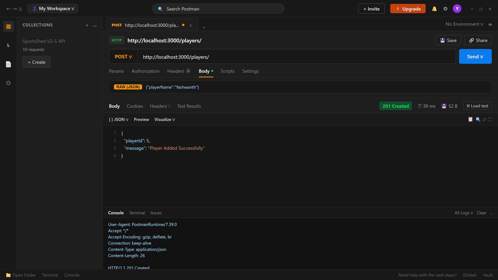

---

### 2. Add Kit
- **Requirement:** Add for kits (name and sport) with the right status code.
- **Method:** `POST`
- **URL:** `http://localhost:3000/kits/`
- **Status:** `201 Created`
- **Request Body:**
  ```json
  {
    "kitName": "Cricket Bat",
    "sport": "Cricket"
  }
  ```


---

### 3. Get All Kits
- **Requirement:** Get all for kits (name and sport) with HTTP 200 OK.
- **Method:** `GET`
- **URL:** `http://localhost:3000/kits/`
- **Status:** `200 OK`

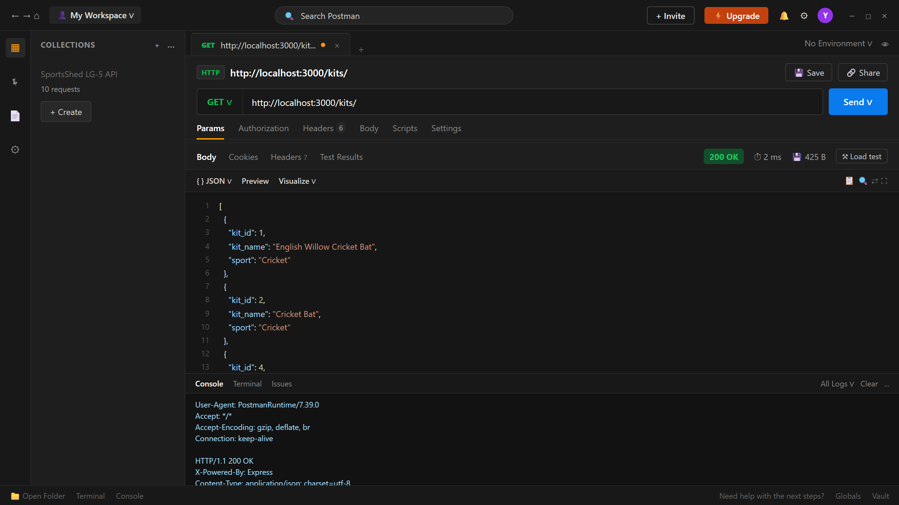

---

### 4. Get One Kit by ID
- **Requirement:** Get one for kits by `kit_id` with HTTP 200 OK.
- **Method:** `GET`
- **URL:** `http://localhost:3000/kits/1/`
- **Status:** `200 OK`

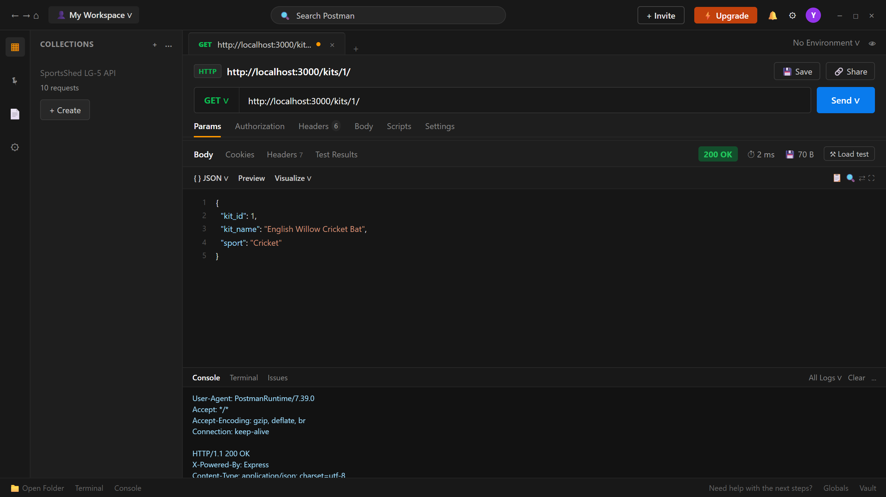

---

### 5. Update Kit
- **Requirement:** Update for kits (name and sport) with HTTP 200 OK.
- **Method:** `PUT`
- **URL:** `http://localhost:3000/kits/1/`
- **Status:** `200 OK`
- **Request Body:**
  ```json
  {
    "kitName": "English Willow Bat",
    "sport": "Cricket"
  }
  ```

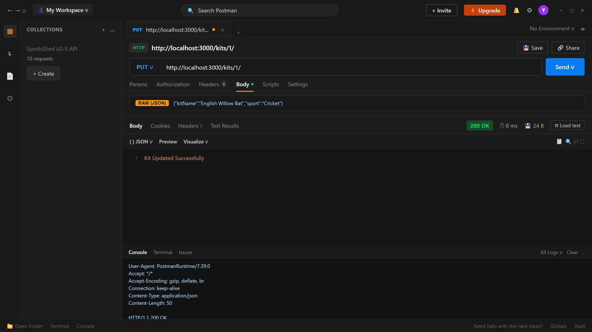

---

### 6. Search Kits by Sport
- **Requirement:** Search by a query parameter, for example kits by sport (`?sport=Cricket`).
- **Method:** `GET`
- **URL:** `http://localhost:3000/kits/?sport=Cricket`
- **Status:** `200 OK`

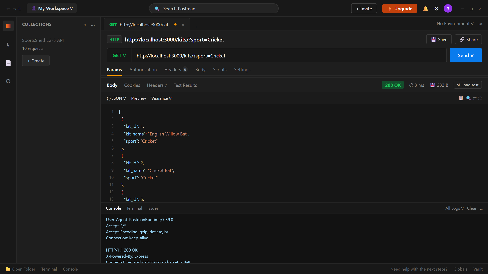

---

### 7. Input Validation Error Handling
- **Requirement:** Validation on add and update, with a clear error message (HTTP 400 Bad Request).
- **Method:** `POST`
- **URL:** `http://localhost:3000/kits/`
- **Status:** `400 Bad Request`
- **Request Body:**
  ```json
  {
    "kitName": ""
  }
  ```
- **Response:** `Kit name and sport are required`

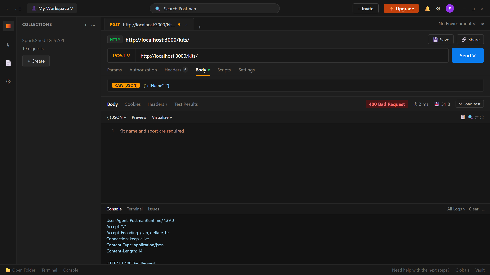

---

### 8. Issue Loan
- **Requirement:** Create loans linking player and kit with foreign keys in SQLite.
- **Method:** `POST`
- **URL:** `http://localhost:3000/loans/`
- **Status:** `201 Created`
- **Request Body:**
  ```json
  {
    "playerId": 1,
    "kitId": 1
  }
  ```

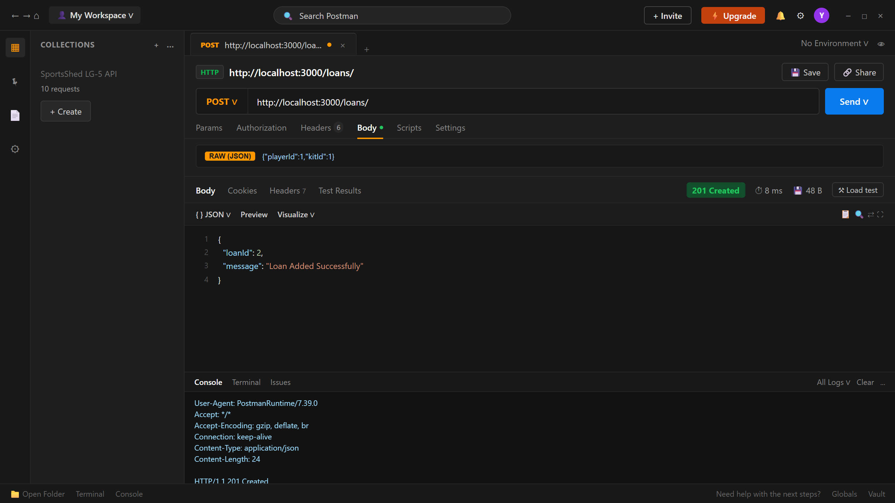

---

### 9. Join Endpoint
- **Requirement:** One join endpoint: loans with the player name and the kit name.
- **Method:** `GET`
- **URL:** `http://localhost:3000/loans/`
- **Status:** `200 OK`

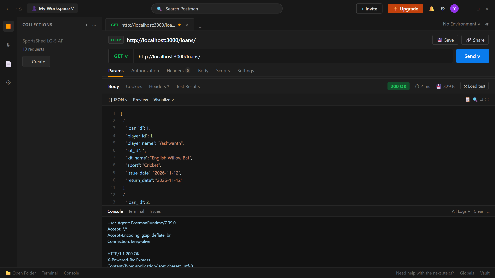

---

### 10. Delete Kit
- **Requirement:** Delete for kits with HTTP 200 OK.
- **Method:** `DELETE`
- **URL:** `http://localhost:3000/kits/2/`
- **Status:** `200 OK`

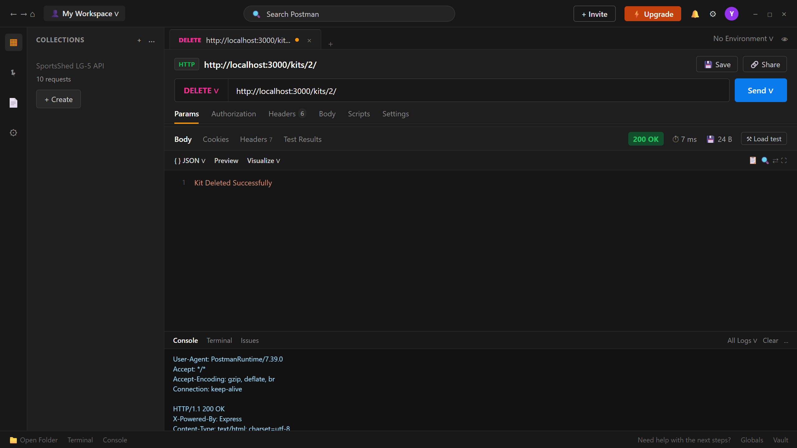

---

## 2. Your Twist: Return Flow (LG-5 Special Requirement)

> **Twist Description:**  
> *"POST /loans/:id/return sets a return date. Returning twice gets 409 and the message 'Already returned'. GET /players/:id/history lists that player's returned loans."*

### Test 1: Return a Loan → 200
- **Brief Specification:** `Return a loan → 200`
- **Method:** `POST`
- **URL:** `http://localhost:3000/loans/1/return`
- **Status:** `200 OK`
- **Response:** `Loan Returned Successfully`

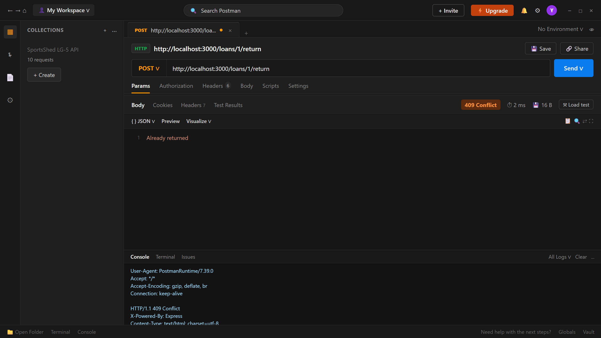

---

### Test 2: Return Again → 409 ("Already returned")
- **Brief Specification:** `Return it again → 409`
- **Method:** `POST`
- **URL:** `http://localhost:3000/loans/1/return`
- **Status:** `409 Conflict`
- **Response:** `Already returned`


---

### Test 3: Player Returned Loan History → 200
- **Brief Specification:** `GET /players/1/history → 200, it is listed`
- **Method:** `GET`
- **URL:** `http://localhost:3000/players/1/history`
- **Status:** `200 OK`

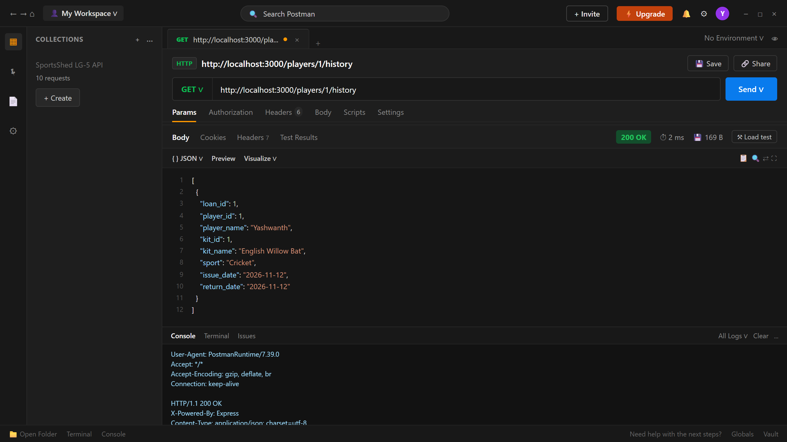
