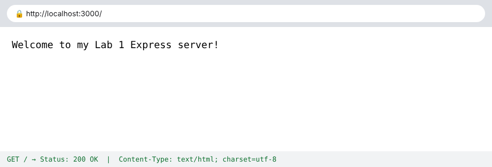
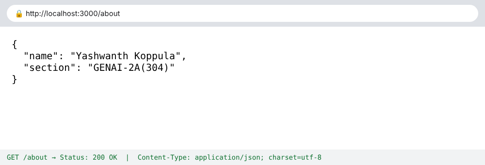
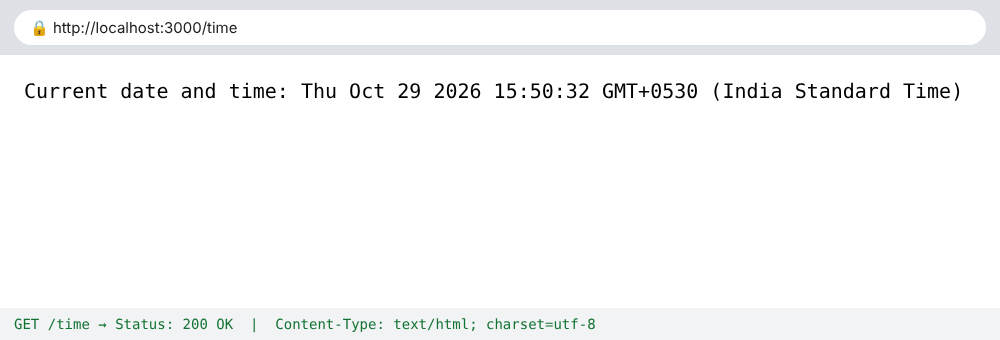
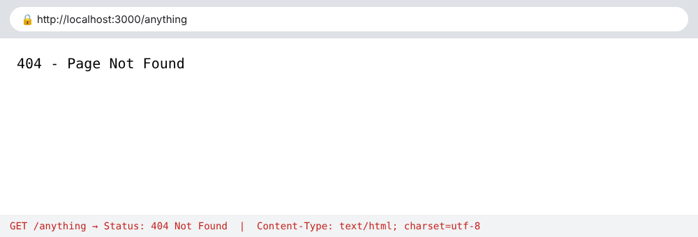

# Lab 1: Node.js and Express server

**Name:** Yashwanth Koppula · **Registration number:** 252U1R9073 · **Section:** GENAI-2A(304)

**Course:** Backend Development Fundamentals

## Live link

**URL:** https://bdf-lab-reports.onrender.com/

## Objective

Set up a Node.js project and build a small web server, first with the built-in `http` module and then with Express.

## How to run

```bash
cd lab-01
npm install          # installs Express into node_modules
npm start            # Express server  -> http://localhost:3000
npm run start:http   # plain http server (Part 1) -> http://localhost:3000
```

**Environment variables:** none required. `PORT` is optional (default `3000`); see `.env.example`. No real values are stored in the repository. Stop one server with `Ctrl + C` before starting the other, as both use port 3000.

## Endpoints

| Method | Path        | Description                                  | Status |
| ------ | ----------- | -------------------------------------------- | ------ |
| GET    | `/`         | Welcome text                                 | 200    |
| GET    | `/about`    | JSON with my name and section                | 200    |
| GET    | `/time`     | Current date and time from `new Date()`      | 200    |
| GET    | any other   | "404 - Page Not Found" (e.g. `/anything`)    | 404    |

`server-http.js` replies `Hello` on `/` (200) and a 404 message on every other path.

## Status codes observed (Task 7)

| Route       | Status code returned |
| ----------- | -------------------- |
| `/`         | 200 OK               |
| `/about`    | 200 OK               |
| `/time`     | 200 OK               |
| `/anything` | 404 Not Found        |

## Screenshots









## package.json fields (Task 1)

| Field          | Meaning                                                   |
| -------------- | --------------------------------------------------------- |
| `name`         | Project name (lowercase, no spaces)                       |
| `version`      | Project version, using semantic versioning (major.minor.patch) |
| `description`  | One-line summary of the project                           |
| `main`         | Entry file used when the project is imported              |
| `scripts`      | Commands run with `npm run <name>` (`npm start` is built in) |
| `keywords`     | Search tags for the npm registry                          |
| `author`       | Who wrote the project                                     |
| `license`      | Licence the code is shared under                          |
| `dependencies` | Packages needed at runtime (Express); added by `npm install express` |

After `npm install express`, Express is found in `node_modules/express`.

## Viva questions

**1. What is the difference between `package.json` and `node_modules`?**  
`package.json` is the project's description: metadata, scripts and the list of dependencies with version ranges. `node_modules` is the folder where the actual downloaded packages are stored. It can always be rebuilt from `package.json` with `npm install`, which is why it is not committed to Git.

**2. What does `app.listen` do?**  
It starts the HTTP server, binds it to a port (3000 here) and begins accepting incoming requests. The optional callback runs once the server is ready.

**3. What do request and response represent?**  
request contains information about the incoming HTTP request. response is used to send data and status codes back to the client.

## Problems Faced and Solutions

- **npm install failed with "Could not read package.json" (ENOENT):** The terminal was open in the outer lab-01 folder created while extracting the zip, and the project was inside a second lab-01 folder. I moved into the inner folder with `cd lab-01` and ran `npm install` again.
- **Deployment root folder:** On Render, the project sits inside the `lab-01` folder of the repository, so I set the Root Directory to `lab-01` so Render could find `package.json`.
- **Unknown routes returned Express's default message:** I added a catch-all `app.use(...)` that returns 404, and placed it *after* all other routes because Express matches in the order routes are defined.
- **Port already in use (`EADDRINUSE`):** running both servers at once clashes on port 3000. I stop one first, or set a different `PORT`.

## Git and Repository Notes

- The `.gitignore` file excludes `node_modules/` and `.env`.
- The `node_modules/` directory must not be committed.
- Screenshots are stored in the `screenshots/` directory.
- The project is submitted through the course GitHub repository.
